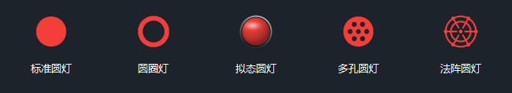

# Agent 红绿灯 · C++ 便携版

下载便携版：[GitHub Releases](https://github.com/Bohrsdice/agent-light/releases)。解压后运行 `CodexLight.exe`；从源码构建后，文件位于 `dist/`。



源码不包含本机聊天记录、账户配置或调试截图；隐私与发布范围见 [PRIVACY.md](PRIVACY.md)。

## 一盏灯起步，按需加灯（0.12.0）

**直接双击 `dist/CodexLight.exe` 或运行 `启动红绿灯.cmd`。默认只有一盏自动跟随的标准圆灯，不带字母。** 同时打开多个 Agent 也不会自动增加图标。后台独立读取 Codex、Cursor、豆包、WorkBuddy、DeepSeek Harness 的原生状态，再将一个 Agent 分配给每盏灯。

右键任意灯：

- **对应 Agent**：自动跟随，或手动指定一个 Agent。
- **样式**：标准圆灯、圆圈灯、拟态圆灯、多孔圆灯、法阵圆灯，共 5 款。样式只改变外观，与 Agent 绑定独立；红、黄、绿、灰表达状态。
- **添加一盏灯**：选择自动或指定 Agent，最多 8 盏。新增灯始终使用相同的默认标准圆灯，不继承其他灯的样式。
- **删除这盏灯**：仅删除当前灯，至少保留一盏作为管理入口。
- 选择当前 Agent 的任务、设置开机启动、退出。

标准款为实心圆；圆圈款为空心圆环；拟态款包含灯珠高光和金属边；多孔款为七孔圆盘；法阵款由同心圆环、径向线和小圆点组成。五种均为原生 C++ 绘制，无需外部图片或运行时联网。换样式不改变绑定，换 Agent 不改变样式；旧方形、菱形和应用标识样式回退为标准圆灯，已有圆圈样式与所有绑定保留。

右键菜单使用原生圆角浮层，跟随系统明暗主题。文字左对齐，取消左侧勾选占位，右侧显示预览、选中标记或子菜单箭头。支持方向键、回车、Esc、外部点击关闭和长列表滚动，不引入网页框架。

悬停显示灯编号、当前 Agent、自动/手动绑定和任务状态。**单击灯打开它当前对应的应用窗口，最小化时还原；有多个窗口时显示选择列表。** 不保证切到具体聊天标签。未匹配到 Agent 时单击打开菜单。通过进程查找窗口，不依赖安装位置，不读取页面判断任务状态。

自动跟随规则：已绑定的运行中或等待确认任务保持绑定，暂时读取失败时也不抢走灯；明确结束后保留约 2 秒再匹配。首次匹配优先最近使用的运行中 Agent，否则优先待回答、较新的运行任务；没有活动任务时跟随最近使用的已打开应用。手动绑定始终保持，即使对应应用关闭也只显示灰灯。额外自动灯避免匹配其他灯已经占用的 Agent；所有候选均占用时保持灰色等待。

每约 2 秒发现应用窗口，最小化仍监控。适配器使用独立工作线程。Cursor/WorkBuddy 被发现时合并注册本机 Hooks（保留并备份原配置），其余只读数据。配置保存至 `%LOCALAPPDATA%/CodexLight/monitor-settings.json`，包含灯的稳定编号、绑定和样式。旧 0.9.0 的多灯配置迁移为一盏自动圆灯。开机启动默认关闭，只有手动勾选才写当前用户启动项。

根目录 `status.json` / `tray-display.json` 的 `lamps` 数组记录实际灯数量、绑定、样式和颜色；`agents` 记录各适配器状态。后台适配器的诊断文件仍在 `agents/<agent>`，其托盘注册状态为 false，因为实际图标由灯管理器控制。灯的 GUID 与稳定编号关联，更换绑定或样式不改变标识。Windows 仍可能将首次出现的灯折叠，需要用户拖出。

`native/lamp-test.cmd` 的 29 项检查覆盖配置迁移、五种样式、自动跟随和绑定独立性；`native/lamp-ui-test.cmd` 的 16 项检查执行真实菜单处理函数及 Windows 托盘注册，验证加删灯、换样式、改绑、离线状态和重载。`native/popup-test.cmd` 的 8 项检查验证原生菜单键盘、子菜单、按钮调用、滚动及关闭清理。测试使用独立临时目录，不修改 Agent 配置或开机启动设置。`native/lamp-preview.cmd` 可生成同一渲染器的 16/24/32/48 像素、明暗背景预览。

旧固定单 Agent 模式保留：`--codex`、`--cursor`、`--doubao`、`--workbuddy`、`--deepseek`。默认与 `--all` 均进入新版灯管理模式；`--home` / `--snapshot` 保留原单 Agent 行为。一个数据目录只允许一个监控进程，切换模式需先退出。0.12.0 仍是原生 C++ 单文件，无额外运行库。旧单 Agent 的 6 项 EXE 集成回归也已通过。

## DeepSeek Harness 模式（0.8.0）

运行 `启动DeepSeek红绿灯.cmd` 或 `CodexLight.exe --deepseek`，切换前退出原托盘实例。已在 Windows / DeepSeek Harness 0.2.2.0 实测。这项适配针对 Harness 桌面 Agent，不包含 DeepSeek 网页聊天。

只读当前用户 `DSH_HOME`（未设置时为 `~/.dsh`）下的 `sessions` 原生 v4 会话日志，不识别页面，不修改 DeepSeek 配置，不注册插件，不读取凭据。支持 `.jsonl` 及默认的 `.jsonl.zstd`；Zstandard 解压器静态编入 EXE，无额外 DLL、Python 或 Node 依赖。`--home` 可指定数据根目录。

- 红灯：`turn/start` 开始执行，问题回答后恢复执行。
- 黄灯：本轮 `ask_user_question` 工具等待回答，或 `approval/asked` 等待确认。
- 绿灯：明确的 `turn/end.reason.kind=completed`。
- 灰灯：中断、出错、离线、未知格式或日志读取异常。

真实桌面测试通过 **红→黄→红→绿**，以及点击“停止生成”后的 **红→灰**。本次原生事件到托盘变化约 0.5～0.6 秒，不承诺固定延迟。权限审批事件已做逻辑适配和测试，尚未实测权限弹窗；普通文字反问不触发黄灯。测试元数据保存于本机 `runtime/deepseek-validation`，不分发对话正文。

每约 500 毫秒增量读取、每 2 秒发现会话；最多跟踪最近 64 份标准会话文件，每轮每文件读取最多 2 MiB，总文件上限 128 MiB，解压帧上限 16 MiB，单条记录上限 4 MiB。验证 Zstd 校验和及事件序号，半条写入时保持未知；子代理及分支继承记录不抢占状态。早于应用进程启动时间的任务不复用。日志格式升级、超限或损坏时显示灰色，不能保证其他版本通用。

32 项 DeepSeek 原生检查覆盖生命周期、多个等待项、旧轮次、子代理、分支继承、真实 Zstd 数据、分段写入、损坏校验、截断和离线。运行 `native/deepseek-test.cmd` 可复现。

实现参考 DeepSeek 官方的 [会话持久化文档](https://github.com/deepseek-ai/deepseek-harness/blob/master/packages/session/session-persistence-jsonl/README.md) 与 [提问工具文档](https://github.com/deepseek-ai/deepseek-harness/blob/master/docs/subsystems/user-questions.md)。Zstandard v1.5.7 的来源及许可证见 `native/vendor/ZSTD-NOTICE.txt`，许可证也嵌入 EXE。

## WorkBuddy 模式（0.6.0）

运行 `启动WorkBuddy红绿灯.cmd` 或 `CodexLight.exe --workbuddy`。切换模式前先退出原托盘实例。EXE 为原生 C++ 单文件，无 Python/Node 依赖。适配已在 WorkBuddy 5.1.7（内置 CLI 2.103.3）验证。

启动时自动合并 `~/.workbuddy/settings.json` 的用户 Hooks，保留原有设置及其他 Hooks，修改前备份。Windows 回调由 WorkBuddy 自带的 Git Bash 启动 EXE，不随红绿灯分发额外运行库。`--install-workbuddy` 只注册，`--uninstall-workbuddy` 只移除本工具的回调。复制到其他电脑或移动 EXE 后，在新位置运行 `--workbuddy` 注册当地路径。`--home` 可覆盖 `.workbuddy` 目录。

- 红灯：原生 `UserPromptSubmit` 回调开始，回答问题后的工具回调恢复运行。
- 黄灯：原生 `Notification.permission_prompt` 的 AskUserQuestion 通知、工具权限回调，或本地 `awaiting_input` 状态。普通文本反问不会被当成等待确认。
- 绿灯：主任务 `Stop` 回调或原生 `turn_completed`。
- 灰灯：应用未连接、状态损坏、明确停止或出错。

真实测试已观察到红→黄→红→绿，并保存了对应的状态文件和托盘注册结果。黄灯回调到托盘本次约 0.8 秒。权限审批分支仅做逻辑适配，尚未实测各类授权弹窗。主进程日志作为恢复及停止/出错的补充来源：WorkBuddy 会缓冲日志，**依赖日志的手动停止/出错识别可能延迟数十秒**；手动停止本轮未完成实际 UI 验证，不能记为验收通过。自定义 Stop 回调要求 agent 继续执行、并行子代理和多权限请求等复杂工作流尚未覆盖。

日志只读取最近 8 个日期目录中的 `workbuddyMainThread__*.log`，每文件初始最多读取末尾 8 MiB，随后增量读取；未发现明确事件时保持灰色。旧应用进程的记录不复用。WorkBuddy 数据库不持久化运行和等待状态，因此不以数据库中的 completed 字段判断当前任务。

运行数据为 `%LOCALAPPDATA%\CodexLight\workbuddy-hooks-state.json`，只保留有限的会话、工具调用标识和状态，不保存提示词及工具参数。回调无输出，不自动批准或拒绝 WorkBuddy 的权限请求。

34 项 WorkBuddy 原生检查通过，覆盖开始/等待/回答/完成/中断、旧轮次、空白会话、损坏/半条日志、截断、服务重启、旧版回调无 ID、主/子代理区分及配置合并/重复安装/卸载。另有 26 项 Cursor、30 项 Codex、9 项豆包回归检查通过。测试记录位于本机 `runtime/workbuddy-validation`，不随 EXE 分发。

## Cursor 模式（0.7.0）

运行 `启动Cursor红绿灯.cmd` 或 `CodexLight.exe --cursor`。自动合并当前用户的 `~/.cursor/hooks.json`，保留其他 hooks；已有文件发生修改前会备份。EXE 使用官方 Hooks 及 Cursor 原生本地记录，不识别页面。移动 EXE 或复制到其他电脑后，需要在新位置运行一次 `--cursor` 注册本机路径。仍共用单个托盘实例，切换前退出原实例。

- 红灯：明确的 `beforeSubmitPrompt` 事件；回答卡片后恢复运行。
- 黄灯：当前轮次的原生 `ask_question` 卡片为 `pending`，无回答结果及用户决定。外层工具即使已记为 completed，也不提前熄灭黄灯。
- 绿灯：明确的 `stop.status=completed` 事件，不能仅凭数据库中 completed 字段判断。
- 灰灯：`stop.status=aborted/error`、应用离线或读取失败。

2026-11-14 在 Windows / Cursor 3.13.25 的 IDE Agent 窗口实测：中文任务 **红→黄→红→绿**，包括待回答状态下重启监控后恢复黄灯；手动点击停止按钮后 **红→灰**。对应 status 与托盘注册状态均已记录于本机 `runtime`，不是测试灯模式。46 项 Cursor 原生检查覆盖原有状态机、UTF-8 原生日志、分段写入、损坏记录、旧轮次隔离、未提交/已提交/异步卡片和 Windows 系统 SQLite 的实际读取。

开始与结束同时读取 `%APPDATA%\Cursor\logs\...\cursor.hooks.*.log` 中原始 UTF-8 INPUT，绕过本机 Hook 标准输入编码/事件落盘问题。只接收明确生命周期事件，不按无输出时长猜测完成。日志最近 4 个启动目录、最多 32 文件，每文件初始末尾 4 MiB，随后增量读取。提问通过 Windows 自带的 `winsqlite3.dll` **只读**查询 `%APPDATA%\Cursor\User\globalStorage\state.vscdb`，仅检查当前会话、当前生成轮次、最新用户消息之后的卡片；不复制数据库，不保存聊天正文，不增加分发 DLL。`--home` 可以覆盖 Cursor 的应用数据根目录。

已改为原生进程快照与窗口所属进程识别 Cursor/WorkBuddy，避免 WMI 超时和独立扩展辅助进程导致误判离线。只用于识别应用是否运行，不读取页面内容判断任务。`native/cursor-integration-test.ps1` 另有 8 项 EXE 集成检查，包含 Windows PowerShell 5.1 UTF-8 管道。

限制：依赖 Cursor 当前日志与数据库内部格式；其他版本、远程窗口、多实例/多任务复杂工作流及系统权限审批未完成实测。普通文字反问不亮黄灯；显式异步卡片不当作阻塞。任务开始/结束需要等待 Cursor 写出 Hook 日志，通常会有数秒延迟。运行中重启 Cursor、禁用 Hooks 或日志缺少开始事件时，可能保持灰色；不能保证所有版本通用。

研究参考：[AgentLights](https://github.com/DanLeonti/AgentLights)、[Signal](https://github.com/thepranky/signal)、[Windows Agent Signal Bar](https://github.com/ridyang/Agent-Signal-Bar-Windows)，以及 [GoCode Notify 的 Cursor 问题检测记录](https://www.npmjs.com/package/@trygocode/notify)。这些项目提供思路，本工具仍是独立 C++ 实现。Cursor 社区也有 [Windows Hook 编码问题复现](https://forum.cursor.com/t/hooks-on-windows-the-powershell-wrapper-reads-the-payload-as-ansi-so-non-ascii-text-reaches-the-hook-double-encoded/172787)。

`--install-cursor` 只注册，`--uninstall-cursor` 仅移除本工具的 hook 条目。记录位于 `%LOCALAPPDATA%\CodexLight\cursor-state.json` 和有界的 `cursor-hooks.jsonl`，只保留事件、状态、ID、项目路径，不保存正文、邮箱或工具参数。仅面向本地 Windows Cursor 任务；云端任务不适用。官方接口参考：https://cursor.com/docs/hooks 。

## 豆包测试模式（0.4.0）

运行 `启动豆包红绿灯.cmd`，或 `CodexLight.exe --doubao`。专用模式切换前先退出原实例；0.9.0 起无参数启动为多 Agent 模式。

豆包模式原生读取当前用户 `AppData/Local/Doubao/User Data/Default/IndexedDB/chrome_doubao-chat_0.indexeddb.leveldb` 的 WAL 增量，不识别页面，不需要 Node 或 Python。只保存任务状态和 ID。支持日志轮换、末尾半条记录和 CRC32C 校验，支持本机观察到的 Snappy/V8 v15 数据格式。

- 红色：当前正在运行。
- 黄色：当前运行消息中存在未回答的原生 `interaction_ask_block` 提问卡片。
- 绿色：当前未运行，**包括正常结束及手动停止**，暂不能区分两者。
- 灰色：未连接、尚未发现新任务、缓存校验失败或需要选择任务。

这是实验性适配，仅验证了本机默认配置及原生选择卡片；普通文字反问、其他权限审批、其他用户配置目录尚未覆盖。首次启动若现存 WAL 不含任务状态，会保持灰色直到新任务写入。未知序列化类型不会解析；内部格式变化可能影响识别。测试通过 6 个实际缓存阶段回放，以及半条写入、校验损坏、应用退出等检查。仓库中的 `native/doubao-test.cmd` 使用完全合成的 V8 / LevelDB 数据，覆盖六个状态阶段、半条写入、校验损坏及应用退出，共 9 项检查。真实缓存记录不进入仓库或发布包。

发布程序：`dist/CodexLight.exe`。单个原生 Windows x64 EXE，只显示系统托盘图标，没有桌面圆点、面板或任务栏按钮。无需 Python、.NET、配置文件、安装程序或管理员权限。静态链接 C/C++ 运行库，仅依赖 Windows 系统 DLL。适用于 Windows 10/11 x64；其他系统未测试。

托盘是否折叠由 Windows 控制，官方接口不允许程序自行固定到时钟旁。首次需要从“∧”拖到时钟旁，或在系统托盘设置中开启显示。图标使用稳定的 GUID，程序原路径更新、重启时保持标识，便于 Windows 记住用户的显示偏好；不能保证系统永久不折叠。

建议把 EXE 放在固定目录后再拖出。移动 EXE 到不同路径会生成新标识，可能需要重新设置显示；复制到另一台电脑也需要该电脑单独设置。右键可以退出或选择任务。旧版的桌面圆点配置已不再使用。

## 自动发现与跟随

1. 优先使用当前用户的 `CODEX_HOME`；未设置时查找用户配置目录下的 `.codex/sessions`。不含固定用户名、会话 ID 或安装位置。
2. 启动时仅有一个有效运行任务就自动绑定；多个任务同时运行则显示灰色，提示右键选择。
3. 当前任务在运行或等待回答时保持绑定，其他任务不能抢占。结束颜色至少保留两秒；另有一个运行任务时跟随它，多个则等待选择，没有新任务则保留结束颜色。
4. 每 3 秒发现新会话；已有会话每约 500 毫秒增量读取。只看明确的任务事件，不识别页面，不根据文件修改时间、CPU 或无输出时长猜测完成。
5. 子代理会话不单独抢占指示灯。早于当前 Codex 服务启动时间的未结束记录视为未知。

## 颜色

| 颜色 | 含义 | 状态值 |
| --- | --- | --- |
| 红 | 正在执行 | 1 |
| 黄 | 等待回答或确认卡片 | null |
| 绿 | 本轮结束 | 0 |
| 灰 | 中断、未连接、等待发现或需要选择任务 | null |

黄灯由原生 `AgentMessage.delivery=async` 的结构化问题卡片触发，按回答中的问题 ID 精确解除。有多个问题时全部回答后才解除；本轮结束但卡片未回答时仍保持黄灯；新一轮开始清理旧等待状态。普通文字问句不会误触发。

绿色表示本轮结束，不代表 AI 已正确完成全部目标。系统权限审批、命令授权、连接器授权弹窗尚未接入。当前针对本地 Codex 桌面 app-server；无本地记录的云端任务不支持。优先识别桌面应用直接启动的 app-server，避免工具启动的辅助服务干扰；仍有多个候选服务时暂不判断。读取的是内部日志格式，已在 Codex `0.167.0-alpha.4.1` 验证，未来版本可能需要适配。

## 体积与数据位置

只复制 EXE 即可使用。运行数据放在 `%LOCALAPPDATA%\CodexLight`，不写入 EXE 所在目录，不写 Codex 数据，不读密钥，不联网。状态文件两秒更新心跳；每份变更日志达到 256 KiB 后轮换，只保留当前和上一份。仅存状态、会话 ID 和项目路径，不复制对话正文。

- `status.json`：真实状态，`value` 为 0、1 或 null，`observed_at_ms` 为 UTC 毫秒心跳。外部读取者超过 15 秒无心跳应显示未知。
- `tray-display.json`：托盘更新结果，`is_test` 标记颜色演示。
- `transitions.jsonl`、`tray-display-events.jsonl`：有界状态变化日志。

## 可选命令

```powershell
.\CodexLight.exe --home 'D:\CustomCodex'
.\CodexLight.exe --snapshot 'C:\Temp\codex-status.json'
.\CodexLight.exe --test-yellow
.\CodexLight.exe --quit
```

`--snapshot` 只检查当前任务并输出 JSON，不创建托盘图标。`--test-yellow` 为运行实例演示黄灯 8 秒。`--quit` 退出运行实例。`--data-dir` 可覆盖运行数据目录用于隔离测试。重复启动同一数据目录会静默退出。

## 构建与验证

安装 Visual Studio 2022 C++ 桌面开发工具和 Windows SDK 后运行：

```powershell
.\native\build.cmd
.\native\test.cmd
```

发布版使用 `/MT /O1 /GL /Gy /Gw /LTCG /OPT:REF /OPT:ICF`，没有使用压缩壳。30 项原生测试覆盖任务生命周期、部分 UTF-8 写入、文件截断/替换、损坏记录、提问与回答、多任务锁定、歧义选择、新会话发现、旧记录排除、服务重启和子代理排除。

JSON 解析使用 nlohmann/json v3.12.0，MIT 许可证在 `native/vendor/LICENSE.nlohmann-json`，并嵌入 EXE 的 RCDATA 100 资源。头文件 SHA-256：`aaf127c04cb31c406e5b04a63f1ae89369fccde6d8fa7cdda1ed4f32dfc5de63`。

根目录 Python 代码和 `tests/` 是先前原型，保留用于对照；发布版不包含或调用它们。原型的配置示例为 `config.example.json`；本机 `config.json` 不纳入 Git。`启动红绿灯.cmd` 已改为启动 C++ EXE。
